<p align="center">
  
</p>

<p align="center">
  <a href="https://code.claude.com/docs/en/plugins"></a>
  <a href="https://developers.openai.com/codex/"></a>
  <a href="https://cursor.com/docs/plugins"></a>
  <a href="https://geminicli.com/docs/extensions/"></a>
  <a href="https://modelcontextprotocol.io/introduction"></a>
  <a href="https://github.com/IvanMurzak/Unity-MCP"></a>
  <a href="https://github.com/IvanMurzak/Unreal-MCP"></a>
  <a href="https://github.com/IvanMurzak/Godot-MCP"></a>
  <a href="https://nodejs.org/"></a>
  <a href="./LICENSE"></a>
  <a href="https://discord.gg/cfbdMZX99G"></a>
  <a href="https://stand-with-ukraine.pp.ua"></a>
</p>

Ask your coding agent for a game and it sets everything up: it creates the engine project, installs
the AI Game Developer plugin, signs you in to [ai-game.dev](https://ai-game.dev), opens the editor
and connects its MCP tools. From there the agent builds the game inside your real editor.

✅ **One prompt to a connected editor** — project, plugin, sign-in, editor and MCP tools<br>
✅ **Unity, Unreal Engine, Godot** — one plugin and one skill per engine<br>
✅ **Four agents, one source** — Claude Code, Codex, Cursor and Gemini CLI<br>
✅ **Nothing installed globally** — every engine CLI runs through `npx`<br>
✅ **Verified before success** — the agent waits until the editor is ready and connected

## 🚀 Quick start

**Claude Code**

```text
/plugin marketplace add IvanMurzak/ai-game-dev-plugin
/plugin install unity-mcp@ai-game-dev-plugin
```

Swap `unity-mcp` for `unreal-mcp` or `godot-mcp`, or install all three. Then just ask:

> _"Make a new Unity game and connect it to ai-game.dev."_

<div align="center">
  
</div>

**Other agents**

| Agent | Install |
| ----- | ------- |
| OpenAI Codex | `codex plugin marketplace add IvanMurzak/ai-game-dev-plugin`<br>`codex plugin add unity-mcp@ai-game-dev-plugin` |
| Cursor | **Customize** → **From GitHub Repository** → `https://github.com/IvanMurzak/ai-game-dev-plugin`, then install `unity-mcp` |
| Gemini CLI | `gemini extensions install https://github.com/IvanMurzak/ai-game-dev-plugin`<br>one extension, all three engines |
| Any agent with skills | `npx skills add IvanMurzak/ai-game-dev-plugin` |

Copying the skills by hand and the ChatGPT / OpenAI plugin-directory package:
[docs/install.md](./docs/install.md).

## 🎮 The plugins

| Engine | Plugin | Drives the CLI | Engine plugin |
| ------ | ------ | -------------- | ------------- |
| **Unity** | `unity-mcp` | [`unity-mcp-cli`](https://www.npmjs.com/package/unity-mcp-cli) | [Unity-MCP](https://github.com/IvanMurzak/Unity-MCP) |
| **Unreal Engine** | `unreal-mcp` | [`unreal-mcp-cli`](https://www.npmjs.com/package/unreal-mcp-cli) | [Unreal-MCP](https://github.com/IvanMurzak/Unreal-MCP) |
| **Godot** | `godot-mcp` | [`godot-cli`](https://www.npmjs.com/package/godot-cli) | [Godot-MCP](https://github.com/IvanMurzak/Godot-MCP) |

Each plugin ships one skill (`unity-game-dev`, `unreal-game-dev`, `godot-game-dev`). It activates by
itself when you ask to create, set up or open a project for its engine.

## 🤖 What the agent does

<p align="center">
  
</p>

Every step runs through `npx -y <engine-cli>@latest`, so nothing is installed globally.

1. **Create** a project (skipped when you already have one).
2. **Install** the AI Game Developer plugin into it.
3. **Sign in** to ai-game.dev: the agent shows you a link and a code to confirm in your browser,
   once per machine.
4. **Restart** the editor (close, then open) so it picks up the sign-in and connects.
5. **Verify** the editor is ready and connected. The agent does not report success before that.
6. **Wire MCP**: `setup-mcp <agent-id>` (`claude-code`, `codex`, `cursor` or `gemini`) registers the
   project's tools with your agent, so it can build the game: scenes, objects, scripts, tests and
   screenshots.

Exact commands, checks and fixes per engine are in the runbooks:
[Unity](./plugins/unity-mcp/skills/unity-game-dev/SKILL.md) ·
[Unreal](./plugins/unreal-mcp/skills/unreal-game-dev/SKILL.md) ·
[Godot](./plugins/godot-mcp/skills/godot-game-dev/SKILL.md).

## ✅ Requirements

- **Node.js 20.19+ or 22.12+** (the CLIs run through `npx`).
- **The engine**: Unity 2022.3+ (through Unity Hub), Unreal Engine 5.5+ with a C++ toolchain, or Godot 4.3+
  **.NET** with the .NET SDK.
- A free **[ai-game.dev](https://ai-game.dev)** account.
- A desktop session: the editor opens a real window.

## 🧩 Related projects

| Project | What it is |
| ------- | ---------- |
| [Unity-MCP](https://github.com/IvanMurzak/Unity-MCP) | AI Game Developer for Unity and `unity-mcp-cli` |
| [Unreal-MCP](https://github.com/IvanMurzak/Unreal-MCP) | AI Game Developer for Unreal Engine and `unreal-mcp-cli` |
| [Godot-MCP](https://github.com/IvanMurzak/Godot-MCP) | AI Game Developer for Godot and `godot-cli` |
| [GameDev-MCP-Server](https://github.com/IvanMurzak/GameDev-MCP-Server) | The one MCP server behind all three engine plugins |
| [ai-game.dev](https://ai-game.dev) | The cloud that connects your agent to the editor |

Questions and showcases: **[Discord](https://discord.gg/cfbdMZX99G)**.

## 🛠️ Contributing

Issues and pull requests are welcome. Edit the canonical runbook in
`plugins/<engine>-mcp/skills/<engine>-game-dev/SKILL.md`, then run `node scripts/sync-skills.mjs`
(and `--check` before you commit). Layout and rules: [`AGENTS.md`](./AGENTS.md); maintenance
scripts: [`scripts/README.md`](./scripts/README.md).

## 📄 License

[Apache-2.0](./LICENSE) © 2026 Ivan Murzak.
