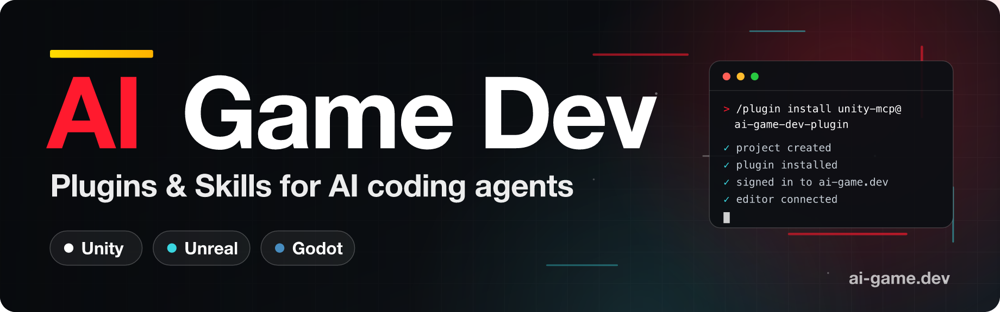

<div align="center" width="100%">

<h1>✨ AI Game Developer — <i>Plugins &amp; Skills</i></h1>

[](https://code.claude.com/docs/en/plugins)
[](https://developers.openai.com/codex/)
[](./plugins)
[](https://modelcontextprotocol.io/introduction)
[](https://github.com/IvanMurzak/Unity-MCP)
[](https://github.com/IvanMurzak/Unreal-MCP)
[](https://github.com/IvanMurzak/Godot-MCP)</br>
[](https://discord.gg/cfbdMZX99G)
[](https://github.com/IvanMurzak/ai-game-dev-plugin/stargazers)
[](./LICENSE)
[](https://stand-with-ukraine.pp.ua)



<p>
  <a href="https://code.claude.com/docs/en/plugins"></a>&nbsp;&nbsp;
  <a href="https://developers.openai.com/codex/"></a>&nbsp;&nbsp;
  <a href="https://cursor.com/docs/plugins"></a>&nbsp;&nbsp;
  <a href="https://geminicli.com/docs/extensions/"></a>
</p>

</div>

Ask your coding agent for a game and it sets everything up: it creates the engine project, installs
the AI Game Developer plugin, signs you in to [ai-game.dev](https://ai-game.dev), opens the editor
and connects its MCP tools. From there the agent builds the game inside your real editor.

One plugin per engine (**Unity**, **Unreal Engine**, **Godot**), each a single **skill** that works
in **Claude Code**, **OpenAI Codex**, **Cursor** and **Gemini CLI** from the same source.

<div align="center">
  
</div>

> **[💬 Join our Discord](https://discord.gg/cfbdMZX99G)** to ask questions and show what you build.

## 🚀 Quick start

### Claude Code

```text
/plugin marketplace add IvanMurzak/ai-game-dev-plugin
/plugin install unity-mcp@ai-game-dev-plugin
```

### OpenAI Codex

```bash
codex plugin marketplace add IvanMurzak/ai-game-dev-plugin
codex plugin add unity-mcp@ai-game-dev-plugin
```

Or open `/plugins` inside Codex and install from the plugin browser.

### Cursor

Open **Customize**, choose **From GitHub Repository** and enter
`https://github.com/IvanMurzak/ai-game-dev-plugin`, then install `unity-mcp`.

Swap `unity-mcp` for `unreal-mcp` or `godot-mcp`, or install all three.

### Gemini CLI

```bash
gemini extensions install https://github.com/IvanMurzak/ai-game-dev-plugin
```

The extension carries all three engine skills.

### ChatGPT / OpenAI plugin directory

[`plugins/ai-game-dev`](./plugins/ai-game-dev) is the **AI Game Developer** package for the OpenAI
plugin directory (ChatGPT and Codex): one connection to `https://ai-game.dev/mcp`, signed in with
your ai-game.dev account, plus the three engine runbooks. It reaches the editors you have open and
signed in to the same account. It is not listed in the directory yet; once it is, install it from
there. Building the upload ZIP: [`scripts/README.md`](./scripts/README.md).

### Any agent with skills (`npx skills`)

```bash
npx skills add IvanMurzak/ai-game-dev-plugin
```

Then just ask:

> _"Make a new Unity game and connect it to ai-game.dev."_

<details>
<summary><b>Copy the skills by hand</b></summary>

Each runbook is a plain `SKILL.md` in [`skills/`](./skills). Copy a `<engine>-game-dev` folder
into your agent's skills directory:

| Agent | Project skills | Personal skills |
| ----- | -------------- | --------------- |
| Claude Code | `.claude/skills/` | `~/.claude/skills/` |
| Codex | `.agents/skills/` | `~/.agents/skills/` |
| Cursor | `.cursor/skills/` | `~/.cursor/skills/` |
| Gemini CLI | `.gemini/skills/` | `~/.gemini/skills/` |

Cursor and Gemini CLI also read `.agents/skills/` and `~/.agents/skills/`.

</details>

## 🎮 The plugins

| Engine | Plugin | Drives the CLI | Engine plugin |
| ------ | ------ | -------------- | ------------- |
|  **Unity** | `unity-mcp` | [`unity-mcp-cli`](https://www.npmjs.com/package/unity-mcp-cli) | [Unity-MCP](https://github.com/IvanMurzak/Unity-MCP) |
|  **Unreal Engine** | `unreal-mcp` | [`unreal-mcp-cli`](https://www.npmjs.com/package/unreal-mcp-cli) | [Unreal-MCP](https://github.com/IvanMurzak/Unreal-MCP) |
|  **Godot** | `godot-mcp` | [`godot-cli`](https://www.npmjs.com/package/godot-cli) | [Godot-MCP](https://github.com/IvanMurzak/Godot-MCP) |

The skill activates by itself when you ask to create, set up or open a project for its engine.

## 🤖 What the agent does

Every step runs through `npx -y <engine-cli>@latest`, so nothing is installed globally.

1. **Create** a project (skipped when you already have one).
2. **Install** the AI Game Developer plugin into it.
3. **Sign in** to ai-game.dev. The agent shows you a link and a code to confirm in your browser.
   You sign in once per machine.
4. **Restart** the editor (close, then open) so it picks up the sign-in and connects to ai-game.dev.
5. **Verify** the editor is ready and connected. The agent does not report success before that.
6. **Wire MCP**: register the project's tools with your agent (`setup-mcp <agent-id>`:
   `claude-code`, `codex`, `cursor` or `gemini`), so it can build the game: scenes, objects, scripts, tests and screenshots.

The exact commands, checks and fixes for each engine are in its runbook:
[Unity](./plugins/unity-mcp/skills/unity-game-dev/SKILL.md) ·
[Unreal](./plugins/unreal-mcp/skills/unreal-game-dev/SKILL.md) ·
[Godot](./plugins/godot-mcp/skills/godot-game-dev/SKILL.md).

## ✅ Requirements

- **Node.js 20.19+ or 22.12+** (the CLIs run through `npx`).
- **The engine**: Unity (through Unity Hub), Unreal Engine 5.5+, or Godot 4.3+ **.NET** with the .NET SDK.
- A free **[ai-game.dev](https://ai-game.dev)** account.
- A desktop session: the editor opens a real window.

## 🧩 Related projects

| Project | What it is |
| ------- | ---------- |
| [Unity-MCP](https://github.com/IvanMurzak/Unity-MCP) | AI Game Developer for Unity: MCP tools, skills and the `unity-mcp-cli` |
| [Unreal-MCP](https://github.com/IvanMurzak/Unreal-MCP) | AI Game Developer for Unreal Engine and `unreal-mcp-cli` |
| [Godot-MCP](https://github.com/IvanMurzak/Godot-MCP) | AI Game Developer for Godot and `godot-cli` |
| [GameDev-MCP-Server](https://github.com/IvanMurzak/GameDev-MCP-Server) | The one MCP server behind all three engine plugins |
| [ai-game.dev](https://ai-game.dev) | The cloud that connects your agent to the editor |

## 🛠️ Contributing

Issues and pull requests are welcome. Edit the canonical runbook in
`plugins/<engine>-mcp/skills/<engine>-game-dev/SKILL.md`, then run `node scripts/sync-skills.mjs`
(and `--check` before you commit). The layout and rules are in [`AGENTS.md`](./AGENTS.md).

## 📄 License

[Apache-2.0](./LICENSE) © 2026 Ivan Murzak.
