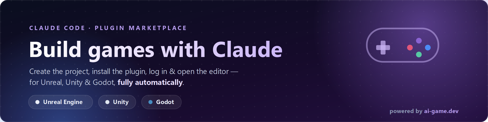

<div align="center">


&nbsp;&nbsp;&nbsp;&nbsp;&nbsp;&nbsp;

&nbsp;&nbsp;&nbsp;&nbsp;&nbsp;&nbsp;


# 🎮 ai-game-dev-plugin

### Build games in Unreal, Unity & Godot — with AI, automatically.

A plugin marketplace for AI coding agents — **[Claude Code](https://docs.anthropic.com/en/docs/claude-code)**
and **[OpenAI Codex CLI](https://developers.openai.com/codex/)** — that teaches the agent to spin up
a real game project, install the engine plugin, log you in, and open the editor connected to the
cloud — so you can build a game just by asking.

[](./LICENSE)
[](https://docs.anthropic.com/en/docs/claude-code)
[](https://developers.openai.com/codex/)
[](https://ai-game.dev)
[](https://ai-game.dev)
[](https://ai-game.dev)
[](https://ai-game.dev)



</div>

---

## What is this?

**ai-game-dev-plugin** is a marketplace of three game-engine plugins — one per engine — for AI
coding agents. Each one teaches the agent to drive that engine's official npm CLI so it can take you
from _nothing_ to a running editor **connected to [ai-game.dev](https://ai-game.dev)** — creating
the project, installing the engine plugin, logging you in, and opening the editor **for you,
automatically.**

It works with **both Claude Code and OpenAI Codex CLI** from one source tree: a single shared skill
per engine, plus a plugin manifest for each agent.

Once connected, the AI can build the game inside your real editor: create the project structure,
spawn objects, edit scenes, wire logic, and iterate — all through your coding agent.

| Engine | Wraps the CLI | It teaches the agent to… |
| ------ | ------------- | ------------------------ |
| **Unreal** | [`unreal-mcp-cli`](https://www.npmjs.com/package/unreal-mcp-cli) | create a UE project, install Unreal-MCP, log in, open in Cloud mode |
| **Unity** | [`unity-mcp-cli`](https://www.npmjs.com/package/unity-mcp-cli) | create a Unity project via Hub, install Unity-MCP, log in, open |
| **Godot** | [`godot-cli`](https://www.npmjs.com/package/godot-cli) | create a C# Godot project, install Godot-MCP, log in, open in Cloud mode |

## 🚀 Quick start

Add the marketplace, then install the plugin(s) for the engine(s) you use.

### Claude Code

```text
/plugin marketplace add IvanMurzak/ai-game-dev-plugin
```

```text
/plugin install unreal@ai-game-dev-plugin
/plugin install unity@ai-game-dev-plugin
/plugin install godot@ai-game-dev-plugin
```

### OpenAI Codex CLI

Register the marketplace from your shell, then install from inside a Codex session:

```bash
codex plugin marketplace add IvanMurzak/ai-game-dev-plugin
```

```text
/plugin install unreal@ai-game-dev-plugin
/plugin install unity@ai-game-dev-plugin
/plugin install godot@ai-game-dev-plugin
```

> **Skills-only alternative (Codex):** the runbooks are also published as repo-native skills under
> [`.agents/skills/`](./.agents/skills). Codex discovers skills by scanning `.agents/skills` from your
> working directory up to the repo root, so you can drop a `<engine>-game-dev` folder into your
> project's `.agents/skills/` (or `~/.agents/skills/`) instead of installing the plugin.

Then just ask:

> _"Set up a new Unreal game with AI and connect it to ai-game.dev."_

## The three plugins

| Engine | Claude Code | Codex CLI |
| ------ | ----------- | --------- |
| Unreal Engine | `/plugin install unreal@ai-game-dev-plugin` | `/plugin install unreal@ai-game-dev-plugin` |
| Unity | `/plugin install unity@ai-game-dev-plugin` | `/plugin install unity@ai-game-dev-plugin` |
| Godot | `/plugin install godot@ai-game-dev-plugin` | `/plugin install godot@ai-game-dev-plugin` |

Each plugin is a single, focused **skill** that auto-activates the moment you ask the agent to
create, set up, or open a project for that engine with AI.

## 🤖 What the AI does automatically

When you ask the agent to set up a game, the skill runs the full end-to-end flow via
`npx -y <engine-cli>@latest`:

1. **Create** — scaffold a fresh engine project (skipped if you already have one).
2. **Install** — add the engine's MCP plugin/addon to the project.
3. **Close** — ensure the editor is not running, so it picks up the new token on next launch.
4. **Login** — an interactive device-code sign-in to [ai-game.dev](https://ai-game.dev); the agent
   relays the verification URL + code for you to open in a browser.
5. **Open** — launch the editor in **Cloud** mode.
6. **Connect** — wait until the editor has actually connected to the cloud (the agent won't claim
   success until this passes).
7. **Wire MCP** — register the project's tools with your agent (`setup-mcp claude-code` for Claude
   Code, `setup-mcp codex` for Codex) so the AI can build the game.

> **Ordering that matters:** the editor is always **closed before login**, and **opened only after
> a successful login**, so the fresh auth token is loaded at startup. The agent enforces this for you.

## ✅ Prerequisites

- **Node.js 18+** (the CLIs run through `npx`).
- The **engine installed** — Unreal Engine, Unity (via Unity Hub), or Godot 4.x **.NET/Mono**
  (Godot C# projects also need the **.NET SDK**).
- A **free [ai-game.dev](https://ai-game.dev) account** for the login step.
- A desktop session — the editors open a real window.

## 🌐 Powered by ai-game.dev

These plugins are the on-ramp to **[ai-game.dev](https://ai-game.dev)** — the cloud that lets AI
build games inside your real engine. The login step authorizes your project against the cloud, and
the editor connects to it so the AI can create and iterate on your game. Bring your own free account;
the plugins wire everything else up.

## 🧩 How it fits together (for contributors)

One source tree serves both agents:

- **Canonical skill** — `plugins/<engine>/skills/<engine>-game-dev/SKILL.md`. Both plugin manifests
  reference the plugin's own `./skills/` directory, so the Claude Code and Codex bundles share this
  one file.
  - Claude Code manifest: `plugins/<engine>/.claude-plugin/plugin.json`
  - Codex manifest: `plugins/<engine>/.codex-plugin/plugin.json`
- **Marketplace catalogs** — `.claude-plugin/marketplace.json` (Claude Code) and
  `.agents/plugins/marketplace.json` (Codex).
- **Repo-native Codex skills** — `.agents/skills/<engine>-game-dev/SKILL.md` are **generated** from
  the canonical skills by [`scripts/sync-skills.mjs`](./scripts). After editing a canonical `SKILL.md`,
  run `node scripts/sync-skills.mjs` to regenerate them, and `node scripts/sync-skills.mjs --check`
  to guard against drift.
- **Agent instructions** — [`AGENTS.md`](./AGENTS.md) (Codex) mirrors the layout and golden rules.

See [`scripts/README.md`](./scripts/README.md) and [`AGENTS.md`](./AGENTS.md) for the full picture.

## 🤝 Contributing

Issues and pull requests are welcome at
**[github.com/IvanMurzak/ai-game-dev-plugin](https://github.com/IvanMurzak/ai-game-dev-plugin)**.
Keep changes focused on the create → install → login → open → connect story, keep all JSON valid,
run `node scripts/sync-skills.mjs --check` before committing, and match the existing skill structure.

## 📄 License

[Apache-2.0](./LICENSE) © 2026 Ivan Murzak.

<div align="center">
<sub>Made for game developers who'd rather build than boilerplate. · <a href="https://ai-game.dev">ai-game.dev</a></sub>
</div>
